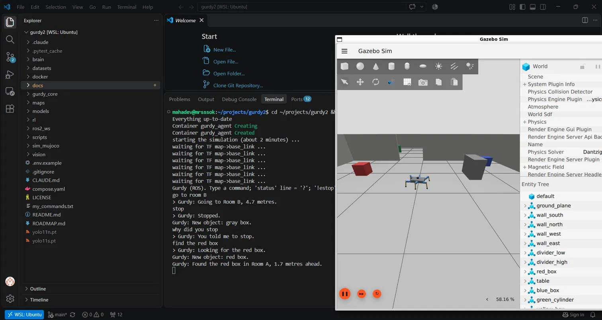
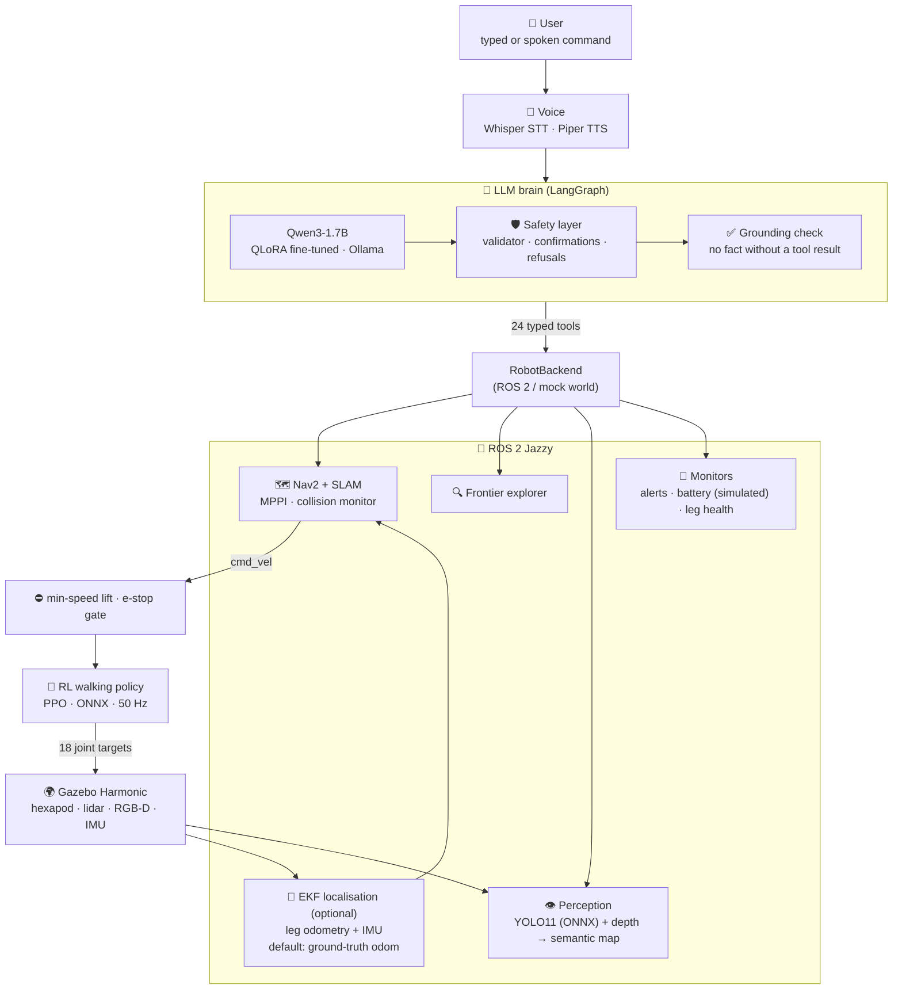
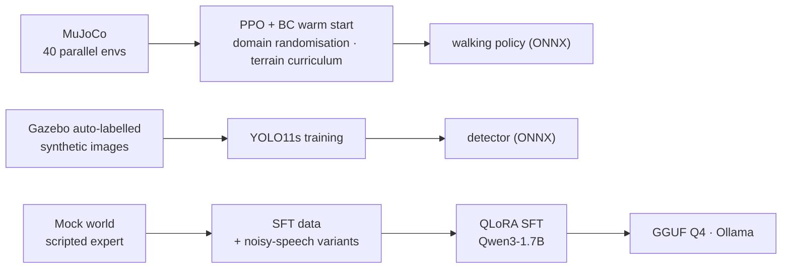
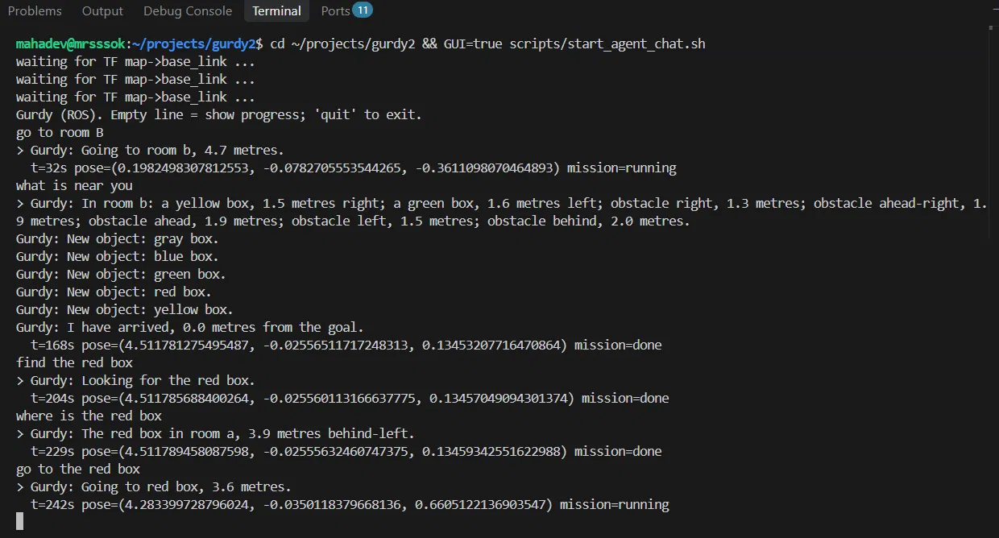
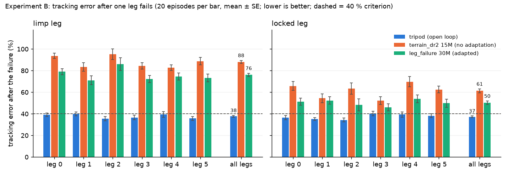
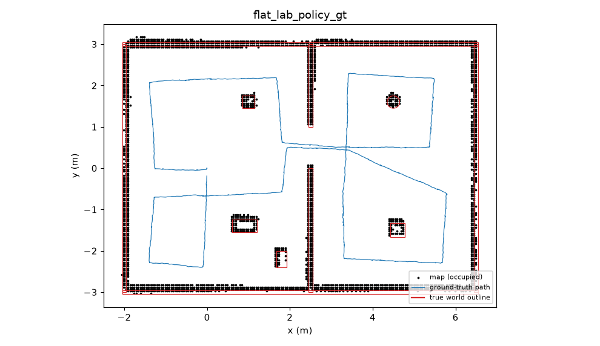

# Gurdy 2.0

An 18-DOF hexapod robot in simulation that takes plain-English commands, plans missions with an offline fine-tuned LLM (Qwen3-1.7B + LoRA, runs locally on a 6 GB laptop GPU),
walks with a PPO-trained RL gait over slopes and steps, builds maps and navigates (slam_toolbox + Nav2), and finds objects by name with a YOLO detector trained on self-generated synthetic data.
Everything runs offline: ROS 2 Jazzy · Gazebo Harmonic · MuJoCo · Docker (WSL2). License: MIT.

**Demo (68 s):** [docs/videos/gurdy2_demo.mp4](docs/videos/gurdy2_demo.mp4) — tripod gait vs the RL policy on a 12° slope and 4 cm steps
(MuJoCo), then autonomous exploration of a lab from an empty map (Gazebo + Nav2 + slam_toolbox).




## Architecture

Runtime:



The LLM decides what to do, Nav2 decides where to go,
and the RL policy decides how to move the 18 joints.
(The live Gazebo test used typed commands; the voice path exists in `brain/voice` but was not part of it.)

Training:



## Headline results (all measured; details linked)

| Area | Result | Details |
|---|---|---|
| RL walking vs tripod gait (MuJoCo) | tracking error 10.6 % vs 15.9 %; cost of transport 5.77 vs 7.35; 0 % falls in all randomisation scenarios; slope 12° 93 % (tripod 100 %); steps 4 cm 83 % (tripod 57 %) | [Experiment A](docs/results/exp_A_terrain.md) |
| Sim-to-sim (MuJoCo → Gazebo) | 0 falls, but tracking differs by up to 14 points on single axes (target ≤ 10 **not met**) | [deploy](docs/results/phase2_deploy_gazebo.md) |
| Mapping (Gazebo) | mean map error 3.1 cm (policy) / 2.4 cm (tripod); autonomous exploration 99.1 % of the lab mapped, Nav2 5/5 goals | [Phase 3](docs/results/phase3_explore.md) |
| Object detection (YOLO11s, synthetic data) | test mAP50 0.922 (v1 test) / 0.871 (harder v2 test); 11/11 objects found in a Gazebo lab, median position error 0.031 m (xy) | [Phase 4](docs/results/phase4c_v2.md) |
| LLM brain, 100 in-distribution commands | base Qwen3-1.7B 59 % → fine-tuned **94 %** (keyword baseline 55 %); 0 risky actions executed | [SFT eval](docs/results/phase5_eval_sft.md) |
| LLM brain, 40 unseen casual phrasings | base 35 % → fine-tuned **65 %** (test set written by an AI assistant, not by humans) | [OOD eval](docs/results/phase5_eval_ood.md) |
| Hallucinated replies | 0 in the final replies (28 checked; a grounding check rejects any fact not in that turn's tool results) | [SFT eval](docs/results/phase5_eval_sft.md) |
| Live LLM-driven Gazebo missions | 9/9 typed missions completed (go-to, find, patrol, stop, refusal, clarification) | [live test](docs/results/phase5_live_test.md) |
| Leg-failure adaptation (negative result) | missed the < 40 % criterion, worse than the open-loop tripod; not deployed | [Experiment B](docs/results/exp_B_leg_failure.md) |

Full per-phase tables are below; all write-ups are in [docs/results/](docs/results/).

## Live run

The fine-tuned brain driving the robot in Gazebo through typed tools (9/9 missions, [details](docs/results/phase5_live_test.md)).

| Gazebo lab | Chat transcript |
|---|---|
|  |  |

## Quick start

```bash
scripts/start_agent_chat.sh     # Gazebo + Nav2 + policy + detector + Ollama brain, then a text chat with the robot
```
Needs Docker (with the NVIDIA runtime), the project's Ollama + the `gurdy-sft-400` model (see [phase5_ros_backend.md](docs/results/phase5_ros_backend.md)). Basic Gazebo demo without the LLM: see "Phase 1 demo" below.

**Status (2026-11-18):** Phases 0–4 done, Phase 5 core (LLM brain, live Gazebo test) in progress; SFT v2 training is under way. Phases 6–9 not started. See [ROADMAP.md](ROADMAP.md).

## Known limitations
- **LLM:** 65 % on unseen casual phrasing; it still invents tool names and unsupported actions on some inputs (nothing invented was executed). The OOD set is assistant-written; noisy-speech cases in the main set are hand-written, not real Whisper output. No voice loop in the live test (typed commands).
- **Hexapod walking:** policies stand still for tiny commands from rest (handled at deployment by lifting Nav2 commands to ≥ 0.09 m/s); steps ≥ 4 cm still fail 17–37 % of episodes for every controller.
- **Sim only:** no real robot. Sim-to-sim gap up to 14 points (31 on one combined segment). Leg-failure adaptation did not work.
- **Single runs:** Nav2, exploration and detector-in-Gazebo were run once per setting, in one world (`flat_lab` / `semantic_lab`); no variance estimates.
- **Perception:** a table and a cylinder are still labelled `box` (7 false tracks in the lab run); detector trained on synthetic images only. Battery is simulated.
- Gazebo RTF drops to ~0.35–0.6 with Nav2 + policy + detector; results are in sim time.

## Results (all measured; MuJoCo unless stated)

**Phase 2 — locomotion.** Selected policy: `terrain_dr2` 15M. Terrain: 30 episodes per cell, success = no fall and tracking error < 50 %
([Experiment A](docs/results/exp_A_terrain.md)).

| | tripod gait | `flat_bc_v1` | `dr_energy_ft` 6M | `terrain_v1` 60M | `terrain_dr2` 15M (selected) |
|---|---|---|---|---|---|
| flat tracking error, nominal | 15.9 % | 4.9 % | 9.2 % | 11.2 % | 10.6 % |
| cost of transport (protocol) | 7.35 | 18.3 | 7.34 | 5.76 | 5.77 |
| tracking error, all DR extremes / falls | 13.8 % / 0 % | 35.1 % / 0 % | 10.3 % / 0 % | 14.2 % / 0 % | 11.2 % / 0 % |
| success: rough 4 cm | 100 % | n/a | 100 % | 100 % | 100 % |
| success: slope 12° / 15° | 100 / 100 % | n/a | 43 / 33 % | 100 / 93 % | 93 / 97 % |
| success: steps 3 / 4 / 5 cm | 83 / 57 / 43 % | n/a | 97 / 77 / 43 % | 93 / 80 / 53 % | 100 / 83 / 63 % |
| Gazebo, worst single-axis gap to MuJoCo | 3–11 pts | not tested | stalls on 4 of 7 segments | 24 pts | 14 pts (combined segment: 31) |

The tripod does not fall on slopes up to 15°; the RL gain there is tracking accuracy (12–18 % vs 17–25 %) and, on steps ≥ 3 cm, success rate.

**Experiment B — one leg fails (limp or locked), blind policy.** Fine-tuning with leg failures reduces the tracking error after the failure
(limp 88 → 76 %, locked 61 → 50 %), but **misses the < 40 % criterion and stays worse than the open-loop tripod gait (38 % / 37 %)**; falls ≤ 1 %.
The adapted policy is not deployed (it also regresses on 15° slopes). 20 episodes per leg × type, MuJoCo flat floor:
[docs/results/exp_B_leg_failure.md](docs/results/exp_B_leg_failure.md).



**Phase 3 — mapping, navigation, exploration (Gazebo).**

| | tripod gait | `terrain_v1` policy |
|---|---|---|
| mapping, ground-truth odom, 38 m route: mean map error / p95 | **2.4 cm** / 6.4 cm | **3.1 cm** / 12.3 cm |

Autonomous exploration from an empty map (frontier explorer + slam_toolbox + Nav2, policy `terrain_dr2`, then back to the start;
[details](docs/results/phase3_explore.md)):

| | ground-truth odom | EKF odom (legs + IMU) |
|---|---|---|
| lab interior mapped / wall+object recall (10 cm) | 99.1 % / 94.9 % | 98.5 % / 93.1 % |
| sim time to finish exploring (+ return) / distance | 345 s (465 s) / 43.8 m | 468 s (510 s) / 47.4 m |
| failed goals / recoveries / stuck events / ends at start | 0 / 0 / 0 / 0.12 m | 1 / 12 / 0 / 0.06 m |

Nav2 with the policy: 5/5 goals on a saved map ([details](docs/results/phase3_selfhit_and_minspeed.md)).
Time-lapse: [GIF](docs/results/phase3_explore_gt_timelapse.gif) · [MP4](docs/results/phase3_explore_gt_timelapse.mp4).

| tripod gait map | policy map |
|---|---|
|  |  |

Details: [flat](docs/results/phase2_flat.md) · [DR](docs/results/phase2_dr.md) · [terrain](docs/results/phase2_terrain.md) ·
[Gazebo transfer](docs/results/phase2_deploy_gazebo.md) · [Phase 3 mapping/Nav2](docs/results/phase3_gazebo_results.md) ·
[3-way video](docs/videos/phase2_3way_tripod_flat_dr.mp4).

## Quick start (Phase 1 demo)

```bash
docker compose build sim
docker compose up sim                 # walking robot in Gazebo (first run builds the workspace)
# second terminal:
docker compose exec sim bash
ros2 run teleop_twist_keyboard teleop_twist_keyboard --ros-args -p speed:=0.1 -p turn:=0.3
docker compose --profile '*' down     # stop everything
```

## Phase 1 results (measured)

| | Result |
|---|---|
| Velocity tracking, Gazebo (vx 0.10 m/s / yaw 0.3 rad/s) | −8.3 % / −11.3 % (limit ±25 %), no fall in 2 min |
| MuJoCo vs Gazebo forward speed | +6.5 % (limit ±30 %) |
| Joint step-response parity Gazebo ↔ MuJoCo | rise time within 4 ms |
| Chatter (60 s standing) | worst joint RMS velocity 4.5e-6 rad/s (limit 1e-2) |

**Phase 2 (in progress) — RL locomotion in MuJoCo** (policies BC-initialised from the tripod gait + PPO):

| | tripod gait | flat policy | DR + energy policy (`dr_energy_ft` 6M, selected) |
|---|---|---|---|
| tracking error, nominal | 15.9 % | 4.9 % | 9.2 % |
| tracking error, all DR extremes | 13.8 % | 35.1 % | 10.3 % |
| tracking error, sensor noise | 16.2 % | 99.2 % | 9.7 % |
| falls (all 9 scenarios) | 0 % | 0 % | 0 % |
| starts from rest (48) | 48/48 | 48/48 | 48/48 |
| cost of transport | 7.35 | 18.3 | 7.34 |
| moves on tiny commands (vx 0.03, vy 0.03, wz 0.1) | yes | mostly | **no (dead zone, fix planned)** |

[flat results](docs/results/phase2_flat.md) · [DR results](docs/results/phase2_dr.md) ·
[3-way video](docs/videos/phase2_3way_tripod_flat_dr.mp4) (DR panel: 40M checkpoint)

Details: [parity + chatter](docs/results/phase1_parity.md) ·
[velocity tracking](docs/results/phase1_tracking.md). Design notes and rules: [CLAUDE.md](CLAUDE.md).

## RL training (Phase 2)

Runs live in `rl/runs/<name>/` (`train.log`, `tb/`, `checkpoints/` every 2M steps incl. VecNormalize
stats; `ppo_latest.*` is written on stop). Training runs detached, so it survives closing VS Code.

```bash
# start (example: long flat run, BC-initialised from the tripod gait)
mkdir -p rl/runs/flat_bc_v1
docker compose run -d --rm --name gurdy_train rl bash -c 'exec python3 rl/train.py \
  --config rl/configs/flat_bc_long.yaml --name flat_bc_v1 \
  --init-from rl/runs/c2_bc/checkpoints/ppo_bc.zip > rl/runs/flat_bc_v1/train.log 2>&1'

# progress
docker ps                                            # gurdy_train running?
tail -f rl/runs/flat_bc_v1/train.log                 # live log (Ctrl+C stops tail, not training)
docker compose run --rm rl python3 rl/tools/summarize_run.py flat_bc_v1   # curves as a table
docker stats --no-stream gurdy_train                 # RAM / CPU
# TensorBoard on http://localhost:6006
docker compose run -d --name gurdy_tb --service-ports rl tensorboard --logdir rl/runs --bind_all --port 6006

# stop (saves ppo_latest), then remove the container
docker stop gurdy_train && docker rm gurdy_train

# resume from the newest checkpoint (or --resume rl/runs/<name>/checkpoints/ppo_<N>_steps.zip)
docker compose run -d --rm --name gurdy_train rl bash -c 'exec python3 rl/train.py \
  --config rl/configs/flat_bc_long.yaml --name flat_bc_v1 --resume latest >> rl/runs/flat_bc_v1/train.log 2>&1'
```
Never run training together with Gazebo (RAM rule); training uses ~1.6 GiB and ~7 CPU threads.
