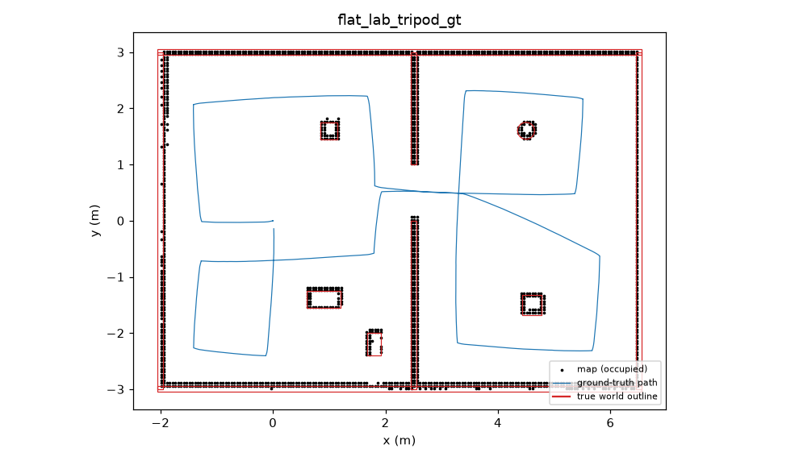

# Gurdy 2.0

An 18-DOF hexapod robot in simulation: Hindi/Hinglish voice commands, an offline fine-tuned LLM
mission planner, an RL gait for rough terrain, mapping + navigation, object finding by name, and a
robot-ops system that clusters failures into incidents and diagnoses root causes.
ROS 2 Jazzy · Gazebo Harmonic · MuJoCo · Docker (WSL2). License: MIT.

**Status (2026-11-16):** Phase 1 (robot + ROS 2 base) complete; Phase 2 (RL locomotion) trained and
evaluated in MuJoCo, Gazebo transfer partly working (gap being closed); Phase 3 (mapping + navigation)
mapping works, Nav2 and EKF odometry still being fixed. See [ROADMAP.md](ROADMAP.md) and
[docs/results/](docs/results/).

## Results so far (all measured; MuJoCo unless stated)

| | tripod gait | `flat_bc_v1` | `dr_energy_ft` 6M | `terrain_v1` 60M (current) |
|---|---|---|---|---|
| flat velocity-tracking error, nominal | 15.9 % | 4.9 % | 9.2 % | 11.2 % |
| cost of transport (protocol) | 7.35 | 18.3 | 7.34 | **5.76** |
| tracking error, all DR extremes / falls | 13.8 % / 0 % | 35.1 % / 0 % | 10.3 % / 0 % | 14.2 % / 0 % |
| terrain success: rough 4 cm / slope 12° / steps 3-4-5 cm | 100 / 100 / 83-57-43 % | n/a | 100 / 43 / 97-77-43 % | 100 / **100** / 93-80-53 % |
| Gazebo sim-to-sim (0 falls in all) | gap 3-11 pts | not tested | stalls on 4 of 7 segments | within ±25 %, gap to MuJoCo up to 22 pts |

| Phase 3 mapping (Gazebo, lidar + slam_toolbox, ground-truth odometry, 38 m route through both rooms) | mean map error | p95 |
|---|---|---|
| tripod gait | **2.4 cm** | 6.4 cm |
| `terrain_v1` policy | **3.1 cm** | 12.3 cm |

| tripod gait map | policy map |
|---|---|
|  |  |

Black = map, red = true world outline, blue = path. Video: [tripod vs flat vs DR policy](docs/videos/phase2_3way_tripod_flat_dr.mp4).
Details: [flat](docs/results/phase2_flat.md) · [DR](docs/results/phase2_dr.md) · [terrain](docs/results/phase2_terrain.md) ·
[Gazebo transfer](docs/results/phase2_deploy_gazebo.md) · [Phase 3 mapping/Nav2](docs/results/phase3_gazebo_results.md).

## Known limitations / in progress
- **Small commands from rest:** `terrain_v1` stands still for |v| ≈ 0.03 m/s from rest (start gate 40/144). Handled at deployment: Nav2 commands
  below 0.05 m/s / 0.15 rad/s are lifted to that minimum; direct teleop of tiny speeds still stands.
- **Sim-to-sim gap:** in Gazebo the policy loses up to 22 points of tracking vs MuJoCo (latency + stance-load/contact differences).
  Fine-tune `terrain_dr2` (wider randomisation) is training now; success target is ≤ 10 points.
- **Nav2 with the policy: not working yet.** First test deadlocked at start (minimum speeds zeroed MPPI's first step); a fix is coded
  but not yet re-tested in Gazebo ([re-test plan](docs/results/phase3_retest.md)). No goal success rate exists yet.
- **EKF (leg odometry + IMU) map is unusable** (1.3 m mean error) although the odometry matched ground truth within 3 cm; cause unknown,
  analysis planned. Only ground-truth odometry maps are good so far.
- Phases 4–9 (perception, voice, LLM, ops, web, air-ground) are not started.

## Quick start (Phase 1 demo)

```bash
docker compose build sim
docker compose up sim                 # walking robot in Gazebo (first run builds the workspace)
# second terminal:
docker compose exec sim bash
ros2 run teleop_twist_keyboard teleop_twist_keyboard --ros-args -p speed:=0.1 -p turn:=0.3
docker compose --profile '*' down     # stop everything
```

## Phase 1 results (measured)

| | Result |
|---|---|
| Velocity tracking, Gazebo (vx 0.10 m/s / yaw 0.3 rad/s) | −8.3 % / −11.3 % (limit ±25 %), no fall in 2 min |
| MuJoCo vs Gazebo forward speed | +6.5 % (limit ±30 %) |
| Joint step-response parity Gazebo ↔ MuJoCo | rise time within 4 ms |
| Chatter (60 s standing) | worst joint RMS velocity 4.5e-6 rad/s (limit 1e-2) |

**Phase 2 (in progress) — RL locomotion in MuJoCo** (policies BC-initialised from the tripod gait + PPO):

| | tripod gait | flat policy | DR + energy policy (`dr_energy_ft` 6M, selected) |
|---|---|---|---|
| tracking error, nominal | 15.9 % | 4.9 % | 9.2 % |
| tracking error, all DR extremes | 13.8 % | 35.1 % | 10.3 % |
| tracking error, sensor noise | 16.2 % | 99.2 % | 9.7 % |
| falls (all 9 scenarios) | 0 % | 0 % | 0 % |
| starts from rest (48) | 48/48 | 48/48 | 48/48 |
| cost of transport | 7.35 | 18.3 | 7.34 |
| moves on tiny commands (vx 0.03, vy 0.03, wz 0.1) | yes | mostly | **no (dead zone, fix planned)** |

[flat results](docs/results/phase2_flat.md) · [DR results](docs/results/phase2_dr.md) ·
[3-way video](docs/videos/phase2_3way_tripod_flat_dr.mp4) (DR panel: 40M checkpoint)

Details: [parity + chatter](docs/results/phase1_parity.md) ·
[velocity tracking](docs/results/phase1_tracking.md). Design notes and rules: [CLAUDE.md](CLAUDE.md).

## RL training (Phase 2)

Runs live in `rl/runs/<name>/` (`train.log`, `tb/`, `checkpoints/` every 2M steps incl. VecNormalize
stats; `ppo_latest.*` is written on stop). Training runs detached, so it survives closing VS Code.

```bash
# start (example: long flat run, BC-initialised from the tripod gait)
mkdir -p rl/runs/flat_bc_v1
docker compose run -d --rm --name gurdy_train rl bash -c 'exec python3 rl/train.py \
  --config rl/configs/flat_bc_long.yaml --name flat_bc_v1 \
  --init-from rl/runs/c2_bc/checkpoints/ppo_bc.zip > rl/runs/flat_bc_v1/train.log 2>&1'

# progress
docker ps                                            # gurdy_train running?
tail -f rl/runs/flat_bc_v1/train.log                 # live log (Ctrl+C stops tail, not training)
docker compose run --rm rl python3 rl/tools/summarize_run.py flat_bc_v1   # curves as a table
docker stats --no-stream gurdy_train                 # RAM / CPU
# TensorBoard on http://localhost:6006
docker compose run -d --name gurdy_tb --service-ports rl tensorboard --logdir rl/runs --bind_all --port 6006

# stop (saves ppo_latest), then remove the container
docker stop gurdy_train && docker rm gurdy_train

# resume from the newest checkpoint (or --resume rl/runs/<name>/checkpoints/ppo_<N>_steps.zip)
docker compose run -d --rm --name gurdy_train rl bash -c 'exec python3 rl/train.py \
  --config rl/configs/flat_bc_long.yaml --name flat_bc_v1 --resume latest >> rl/runs/flat_bc_v1/train.log 2>&1'
```
Never run training together with Gazebo (RAM rule); training uses ~1.6 GiB and ~7 CPU threads.
