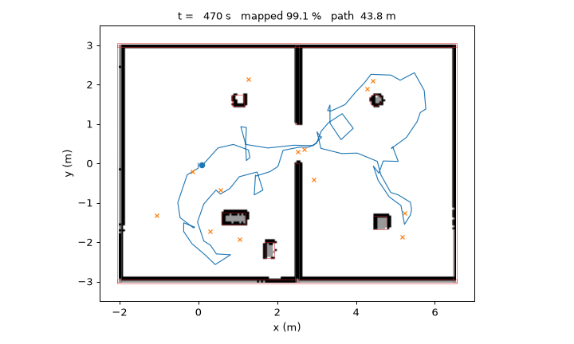
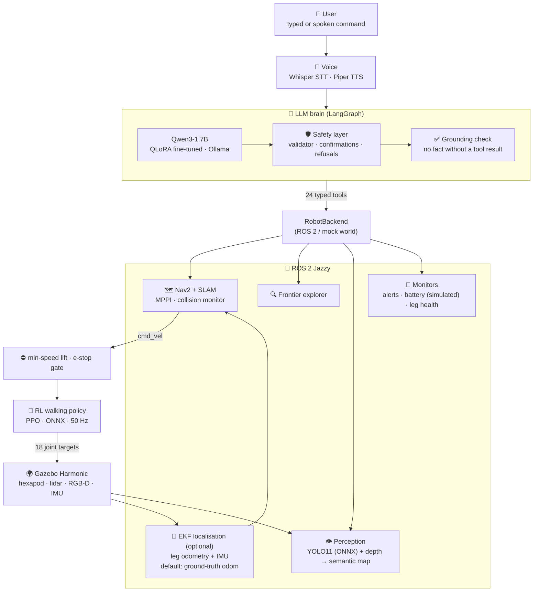
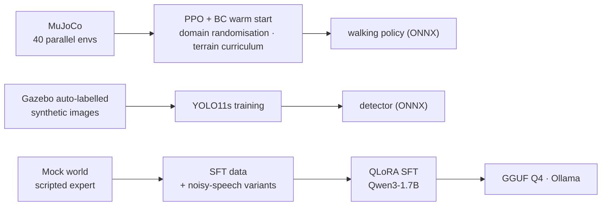
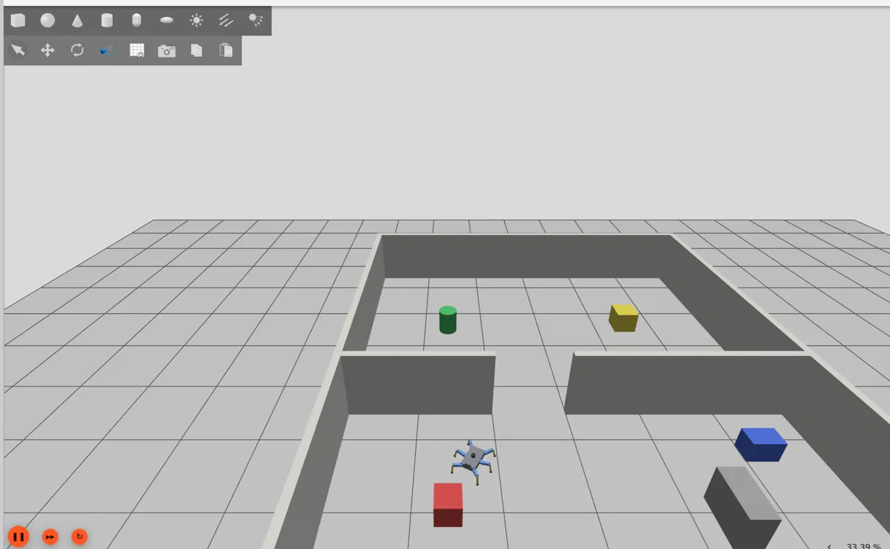

# Gurdy 2.0

An 18-DOF hexapod robot in simulation that takes plain-English commands, plans missions with an offline fine-tuned LLM (Qwen3-1.7B + LoRA, runs locally on a 6 GB laptop GPU),
walks with a PPO-trained RL gait over slopes and steps, builds maps and navigates (slam_toolbox + Nav2), and finds objects by name with a YOLO detector trained on self-generated synthetic data.
Everything runs offline: ROS 2 Jazzy · Gazebo Harmonic · MuJoCo · Docker (WSL2). License: MIT.

**Demo (68 s):** [docs/videos/gurdy2_demo.mp4](docs/videos/gurdy2_demo.mp4) — tripod gait vs the RL policy on a 12° slope and 4 cm steps
(MuJoCo), then autonomous exploration of a lab from an empty map (Gazebo + Nav2 + slam_toolbox).




## Architecture

Runtime:



The LLM decides what to do, Nav2 decides where to go,
and the RL policy decides how to move the 18 joints.
(The live Gazebo test used typed commands; the voice path exists in `brain/voice` but was not part of it.)

Training:



## Headline results (all measured; details linked)

| Area | Result | Details |
|---|---|---|
| RL walking vs tripod gait (MuJoCo) | tracking error 10.6 % vs 15.9 %; cost of transport 5.77 vs 7.35; 0 % falls in all randomisation scenarios; slope 12° 93 % (tripod 100 %); steps 4 cm 83 % (tripod 57 %) | [Experiment A](docs/results/exp_A_terrain.md) |
| Sim-to-sim (MuJoCo → Gazebo) | 0 falls, but tracking differs by up to 14 points on single axes (target ≤ 10 **not met**) | [deploy](docs/results/phase2_deploy_gazebo.md) |
| Mapping (Gazebo) | mean map error 3.1 cm (policy) / 2.4 cm (tripod); autonomous exploration 99.1 % of the lab mapped, Nav2 5/5 goals | [Phase 3](docs/results/phase3_explore.md) |
| Object detection (YOLO11s, synthetic data) | test mAP50 0.922 (v1 test) / 0.871 (harder v2 test); 11/11 objects found in a Gazebo lab, median position error 0.031 m (xy) | [Phase 4](docs/results/phase4c_v2.md) |
| LLM brain, 100 in-distribution commands | base Qwen3-1.7B 59 % → fine-tuned **94 %** (keyword baseline 55 %); 0 risky actions executed | [SFT eval](docs/results/phase5_eval_sft.md) |
| LLM brain, 40 unseen casual phrasings | base 35 % → fine-tuned **65 %** (test set written by an AI assistant, not by humans) | [OOD eval](docs/results/phase5_eval_ood.md) |
| Hallucinated replies | 0 in the final replies (28 checked; a grounding check rejects any fact not in that turn's tool results) | [SFT eval](docs/results/phase5_eval_sft.md) |
| Live LLM-driven Gazebo missions | 9/9 typed missions completed (go-to, find, patrol, stop, refusal, clarification) | [live test](docs/results/phase5_live_test.md) |
| Leg-failure adaptation (negative result) | missed the < 40 % criterion, worse than the open-loop tripod; not deployed | [Experiment B](docs/results/exp_B_leg_failure.md) |

Per-phase tables and RL training commands: [docs/RESULTS.md](docs/RESULTS.md). All write-ups: [docs/results/](docs/results/). The selected walking policy everywhere is `terrain_dr2` 15M.

## Live run

The fine-tuned brain driving the robot in Gazebo through typed tools (9/9 missions, [details](docs/results/phase5_live_test.md)).

| Gazebo lab | Chat transcript |
|---|---|
|  |  |

## Quick start

**Needs:** Linux or WSL2 with Docker and the NVIDIA container runtime (an NVIDIA GPU with ≥ 6 GB VRAM; tested on an RTX 4050 Laptop), and [Ollama](https://ollama.com) (this project runs its own instance on port 11435).

```bash
docker compose build sim brain                # ROS 2 / Gazebo image + brain image
scripts/start_agent_chat.sh                   # Gazebo + Nav2 + policy + detector + Ollama brain, then a text chat
```

**The `gurdy-sft-400` model is not published yet** (publishing it on Hugging Face is planned), so build it yourself. The script expects an Ollama model with that name:
1. Generate the SFT data and fine-tune Qwen3-1.7B with QLoRA: `scripts/p5_datagen.sh`, then `scripts/p5_sft.sh` ([data](docs/results/phase5_datagen.md)).
2. Merge the LoRA adapter into the fp16 base, convert to GGUF with llama.cpp `convert_hf_to_gguf.py` (tag b12494), quantise to Q4_K_M with `llama-quantize` ([details](docs/results/phase5_eval_sft.md)). These two steps were done by hand, there is no single script yet.
3. `ollama create gurdy-sft-400 -f brain/tools/Modelfile.sft` (the Modelfile carries the exact training prompt template; put the `.gguf` next to it).

Without the LLM: `docker compose up sim` starts the walking robot in Gazebo (teleop commands in [docs/RESULTS.md](docs/RESULTS.md)). Retraining the walking policy: [docs/RESULTS.md](docs/RESULTS.md#rl-training-commands-phase-2).

## Known limitations
- **LLM:** 65 % on unseen casual phrasing; it still invents tool names and unsupported actions on some inputs (nothing invented was executed). The OOD set is assistant-written; noisy-speech cases in the main set are hand-written, not real Whisper output. No voice loop in the live test (typed commands).
- **Hexapod walking:** policies stand still for tiny commands from rest (handled at deployment by lifting Nav2 commands to ≥ 0.09 m/s); steps ≥ 4 cm still fail 17–37 % of episodes for every controller.
- **Sim only:** no real robot. Sim-to-sim gap up to 14 points (31 on one combined segment). Leg-failure adaptation did not work.
- **Single runs:** Nav2, exploration and detector-in-Gazebo were run once per setting, in one world (`flat_lab` / `semantic_lab`); no variance estimates.
- **Perception:** a table and a cylinder are still labelled `box` (7 false tracks in the lab run); detector trained on synthetic images only. Battery is simulated.
- Gazebo RTF drops to ~0.35–0.6 with Nav2 + policy + detector; results are in sim time.

## Status (2026-11-18)

Phases 0–4 done. Phase 5 core (LLM brain, live Gazebo test) done; SFT v2 training is running. Phases 6–9 not started. See [ROADMAP.md](ROADMAP.md) and [CLAUDE.md](CLAUDE.md).
