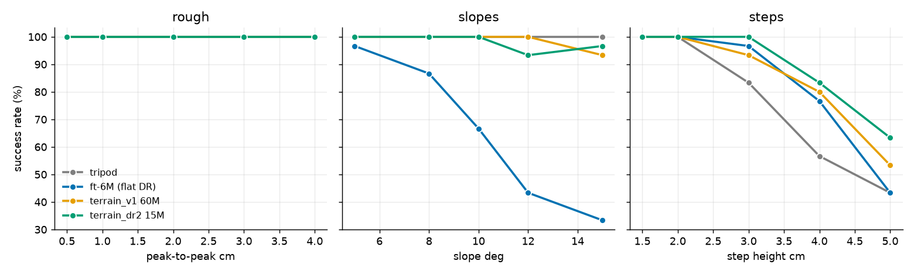
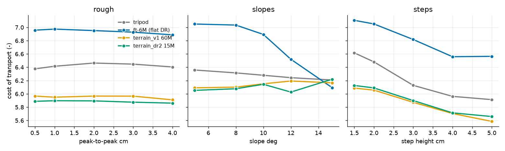

# Experiment A — terrain: tripod vs RL policies (MuJoCo)

Built from existing eval data only (no new runs): `docs/results/phase2_terrain_eval.json` (tripod, ft-6M, terrain_v1) and
`rl/runs/terrain_dr2/eval/eval_terrain.json` (terrain_dr2). Regenerate charts + table (`exp_A_table.md`, pasted below): `docker compose run --rm rl python3 scripts/exp_a_report.py`.
Protocol: `rl/eval.py --terrain all`, DR off, 30 episodes per cell, the same terrain realisations for every controller (seed-determined),
standard command distribution. **Success** = no fall and episode mean window tracking error < 50 %. Error = mean window tracking error.
CoT = energy / (m·g·path). Each cell below: `success / falls / tracking error / CoT`. n = 30 per cell, so one episode = 3.3 points; differences of
< ~10 points in success are within noise (no confidence intervals computed).

## Results
| terrain | level | tripod | ft-6M (flat DR) | terrain_v1 60M | terrain_dr2 15M |
|---|---|---|---|---|---|
| rough | 0.5 | 100 % / 0 % / 17 % / 6.4 | 100 % / 0 % / 8 % / 7.0 | 100 % / 0 % / 11 % / 6.0 | 100 % / 0 % / 10 % / 5.9 |
| rough | 1 | 100 % / 0 % / 17 % / 6.4 | 100 % / 0 % / 8 % / 7.0 | 100 % / 0 % / 11 % / 5.9 | 100 % / 0 % / 10 % / 5.9 |
| rough | 2 | 100 % / 0 % / 19 % / 6.5 | 100 % / 0 % / 9 % / 7.0 | 100 % / 0 % / 11 % / 6.0 | 100 % / 0 % / 10 % / 5.9 |
| rough | 3 | 100 % / 0 % / 22 % / 6.4 | 100 % / 0 % / 11 % / 6.9 | 100 % / 0 % / 13 % / 6.0 | 100 % / 0 % / 11 % / 5.9 |
| rough | 4 | 100 % / 0 % / 26 % / 6.4 | 100 % / 0 % / 14 % / 6.9 | 100 % / 0 % / 15 % / 5.9 | 100 % / 0 % / 13 % / 5.9 |
| slopes | 5 | 100 % / 0 % / 17 % / 6.4 | 97 % / 0 % / 15 % / 7.0 | 100 % / 0 % / 12 % / 6.1 | 100 % / 0 % / 14 % / 6.1 |
| slopes | 8 | 100 % / 0 % / 19 % / 6.3 | 87 % / 0 % / 29 % / 7.0 | 100 % / 0 % / 13 % / 6.1 | 100 % / 0 % / 14 % / 6.1 |
| slopes | 10 | 100 % / 0 % / 21 % / 6.3 | 67 % / 3 % / 44 % / 6.9 | 100 % / 0 % / 14 % / 6.2 | 100 % / 0 % / 14 % / 6.1 |
| slopes | 12 | 100 % / 0 % / 23 % / 6.2 | 43 % / 3 % / 63 % / 6.5 | 100 % / 0 % / 15 % / 6.2 | 93 % / 7 % / 15 % / 6.0 |
| slopes | 15 | 100 % / 0 % / 25 % / 6.2 | 33 % / 7 % / 76 % / 6.1 | 93 % / 7 % / 17 % / 6.2 | 97 % / 3 % / 18 % / 6.2 |
| steps | 1.5 | 100 % / 0 % / 22 % / 6.6 | 100 % / 0 % / 14 % / 7.1 | 100 % / 0 % / 15 % / 6.1 | 100 % / 0 % / 14 % / 6.1 |
| steps | 2 | 100 % / 0 % / 25 % / 6.5 | 100 % / 0 % / 17 % / 7.1 | 100 % / 0 % / 17 % / 6.1 | 100 % / 0 % / 16 % / 6.1 |
| steps | 3 | 83 % / 0 % / 36 % / 6.1 | 97 % / 0 % / 27 % / 6.8 | 93 % / 0 % / 29 % / 5.9 | 100 % / 0 % / 25 % / 5.9 |
| steps | 4 | 57 % / 0 % / 50 % / 6.0 | 77 % / 0 % / 40 % / 6.6 | 80 % / 0 % / 38 % / 5.7 | 83 % / 0 % / 36 % / 5.7 |
| steps | 5 | 43 % / 0 % / 60 % / 5.9 | 43 % / 0 % / 53 % / 6.6 | 53 % / 0 % / 48 % / 5.6 | 63 % / 0 % / 45 % / 5.7 |

Controllers: tripod = Phase 1 open-loop gait; ft-6M = `dr_energy_ft` (flat, DR, energy; never saw terrain); terrain_v1 60M = terrain curriculum from ft-6M;
terrain_dr2 15M = terrain_v1 + wider DR (selected policy). Units: rough = peak-to-peak cm, slopes = deg, steps = step height cm.

## What it shows
- **Rough ground (≤ 4 cm):** nobody falls or fails. The policies track better (10–13 % vs the tripod's 17–26 %, the gap growing with roughness) and use ~8 % less energy than the tripod (CoT 5.9 vs 6.4); ft-6M is the least efficient (7.0).
- **Slopes:** the tripod never fails up to 15° (100 %, but tracking degrades 17 → 25 %). The flat policy ft-6M collapses (43 % at 12°, 33 % at 15°, error 63–76 %) — it needs the terrain curriculum. terrain_v1 / dr2 hold 93–100 % at every angle with error 12–18 %. So on slopes the RL gain is **tracking accuracy and robustness over the flat policy**, not survival over the tripod.
- **Steps:** the hardest case and the only one where the tripod's success drops (83 % at 3 cm, 57 % at 4 cm, 43 % at 5 cm). terrain_dr2 is best at every height ≥ 3 cm (100 / 83 / 63 %) but only moderately: at 5 cm it still fails 37 %. Step-up of 4–5 cm (≈ leg clearance limit) remains open. Nobody *falls* on steps — failures are the robot stalling/tracking < 50 %.
- **terrain_dr2 vs terrain_v1:** equal within noise on rough/slopes; slightly better on steps (+3…+10 points, not significant at n = 30). Its reason for existing is the Gazebo transfer (`phase2_9b_nav_results.md`), not MuJoCo terrain scores.
- **Energy:** terrain policies are ~5–8 % below the tripod on every terrain; the flat-trained ft-6M is 8–10 % above it.

## Caveats
Single MuJoCo seed set, 30 episodes/cell, no CIs; terrain types are generated by our own simple generators (random bumps, planar slope, random blocks) in a 10 m map, robot always starts on the level patch; Gazebo results differ (sim-to-sim gap up to 14 points, `phase2_9b_nav_results.md`).
