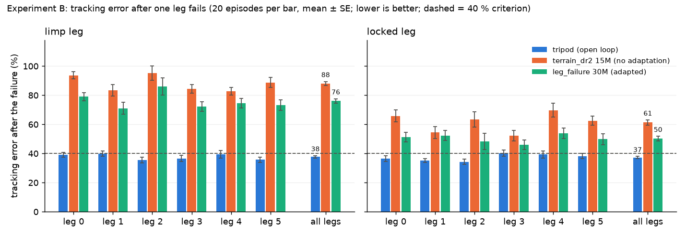

# Experiment B — leg-failure adaptation

**Result (2026-11-16): the success criterion is NOT met.** Fine-tuning with leg failures helps (limp 88 → 76 %, locked 61 → 50 %
tracking error after the failure), but the adapted policy stays far above the 40 % criterion and **worse than the open-loop tripod
gait (38 % / 37 %)**. Full results in [Results](#results-2026-11-16); the sections before it are the plan as written before training.

Question: can a blind RL policy keep walking when one leg dies, if it has to infer the failure from proprioception alone?

## Failure model (implemented in `rl/envs/randomization.py`, `rl/envs/gurdy_env.py`)
- In a fraction `leg_failure_prob` (0.5 in training) of episodes one random leg (0–5) fails at a random time (uniform 1–10 s of a 20 s episode).
- **limp**: the 3 motors of that leg produce zero torque from then on (leg flops; joint damping/friction remain).
- **locked**: the PD target of the 3 joints is frozen at the joint angles of the failure moment (the servo holds that pose).
- Type chosen 50/50. The failure is applied inside `env.step` (`_maybe_fail_leg`); `reset` restores the healthy robot.
- **Actor is not told:** its 195 inputs are unchanged (joint positions/velocities, gyro, gravity, command, previous actions, 3-frame history). Test: actor obs shape unchanged, no failure flag.
- **Critic is told** (`failure_privileged: true`): +8 privileged values = one-hot failed leg (6, zero before the failure) + limp flag + locked flag. The critic input grows 212 → 220;
  `policies.extend_privileged` copies terrain_dr2 (actor identical, new critic columns start at 0; tested).
- Episodes with a failure do not move the terrain curriculum (a fall caused by the failure must not demote the terrain level).

## Training (`rl/configs/leg_failure.yaml`, run name `leg_failure`)
Fine-tune from `terrain_dr2` 15M (`rl/runs/terrain_dr2/checkpoints/ppo_latest.zip`), 30M steps, full DR (as terrain_dr2), terrain = flat 35 % / rough ≤ 2 cm / slopes ≤ 8° / steps ≤ 2.5 cm,
critic warm-up 0.41M steps with the actor frozen (new critic inputs), everything else (reward, PPO, command mix) as terrain_dr2. No reward change: tracking reward under a dead leg is simply lower.

## Baseline observation before training (smoke eval, 2 episodes per cell, so only indicative)
terrain_dr2 *without* adaptation degrades badly under a limp leg (post-failure tracking error ≈ 90 % vs the tripod's ≈ 39 %), and less under a locked leg (≈ 63 % vs 38 %); no falls anywhere
(the robot has 5 legs left, it stalls/drifts rather than falls). Falls are therefore a weak metric here; tracking error and CoT are the main ones.
Real numbers come from the full evaluation below.

## Evaluation plan (`rl/eval_failure.py`; run after training, MuJoCo, flat floor, DR off, nothing else running)
```bash
docker compose run --rm rl python3 rl/eval_failure.py --policies terrain_dr2:latest leg_failure:latest --episodes 10
```
- Controllers: tripod (no adaptation), `terrain_dr2` 15M (no adaptation), `leg_failure` (candidate checkpoints: 20M and latest; pick with the rule below).
- Cells: every failed leg (0–5) × type (limp, locked) × 10 episodes (same seeds and commands for every controller), plus 50 no-failure episodes.
- The failure happens at 5 s (end of the first command window). **Metrics on the windows after the failure only** (first second of each window skipped): fall rate (whole episode), tracking error
  (episode mean of window errors, `rl/eval.py` definition), CoT = energy / (m g path) after the failure. Pooled rows over the 6 legs per type.
- **No-failure regression check:** the no-failure row (50 episodes) vs `terrain_dr2`, plus `rl/eval.py --policies terrain_dr2:latest leg_failure:latest --scenarios all` (9 DR scenarios), `--terrain all` and the start gate;
  accept the candidate only if nominal tracking error ≤ 12 % (terrain_dr2: 10.6 %), 0 falls in the DR scenarios, and rough/slopes/steps success within 10 points of terrain_dr2.
- Success criterion for the experiment (set before seeing results): post-failure tracking error pooled over legs < 40 % for both failure types (tripod ≈ 38 %) and clearly below terrain_dr2 without adaptation; report per-leg results including the worst leg. If the criterion is missed, say so.
- Not covered (limitations): simultaneous failures, failure of a single joint, partial torque loss, failures on terrain, Gazebo transfer.

## Results (2026-11-16)
Run: `leg_failure`, 30.0M steps, 3.94 h. Evaluation exactly as planned but with **20 episodes per cell** (same seeds/commands for every controller),
50 no-failure episodes, MuJoCo, flat floor, DR off, failure at 5 s, metrics on the 15 s after it.
`docker compose run --rm rl python3 rl/eval_failure.py --policies terrain_dr2:latest leg_failure:20000000 leg_failure:latest --episodes 20` (455 s);
data `exp_B_leg_failure.json`, table/chart `python3 scripts/exp_b_report.py`.



Cell = falls / tracking error after the failure (mean ± SE over episodes) / CoT after the failure. Legs 0–5 as in `robot.yaml`.

| failure | tripod | terrain_dr2 15M | leg_failure 20M | leg_failure 30M |
|---|---|---|---|---|
| none | 0 % / 17 ± 1 % / 6.2 | 0 % / 10 ± 0 % / 5.9 | 0 % / 11 ± 0 % / 6.3 | 0 % / 10 ± 0 % / 6.2 |
| limp:0 | 0 % / 39 ± 2 % / 5.4 | 0 % / 94 ± 3 % / 4.3 | 0 % / 81 ± 3 % / 5.2 | 0 % / 79 ± 3 % / 5.2 |
| limp:1 | 0 % / 40 ± 2 % / 5.9 | 0 % / 83 ± 4 % / 5.6 | 0 % / 71 ± 3 % / 5.5 | 0 % / 71 ± 4 % / 5.6 |
| limp:2 | 0 % / 36 ± 2 % / 5.4 | 0 % / 95 ± 5 % / 4.5 | 15 % / 102 ± 3 % / 5.4 | 5 % / 86 ± 6 % / 5.6 |
| limp:3 | 0 % / 37 ± 2 % / 5.4 | 0 % / 84 ± 3 % / 4.5 | 0 % / 74 ± 3 % / 4.7 | 0 % / 72 ± 3 % / 5.0 |
| limp:4 | 0 % / 39 ± 3 % / 5.8 | 0 % / 83 ± 3 % / 4.6 | 0 % / 73 ± 3 % / 5.2 | 0 % / 75 ± 3 % / 5.5 |
| limp:5 | 0 % / 36 ± 2 % / 5.4 | 0 % / 89 ± 4 % / 4.6 | 0 % / 77 ± 4 % / 4.7 | 0 % / 73 ± 4 % / 4.6 |
| locked:0 | 0 % / 37 ± 2 % / 5.7 | 0 % / 66 ± 4 % / 5.9 | 0 % / 53 ± 3 % / 6.9 | 0 % / 51 ± 3 % / 7.0 |
| locked:1 | 0 % / 35 ± 1 % / 6.9 | 0 % / 54 ± 4 % / 5.8 | 0 % / 51 ± 3 % / 6.0 | 0 % / 52 ± 3 % / 5.8 |
| locked:2 | 0 % / 34 ± 2 % / 5.7 | 0 % / 63 ± 5 % / 5.5 | 0 % / 56 ± 6 % / 6.3 | 0 % / 48 ± 5 % / 6.3 |
| locked:3 | 0 % / 40 ± 2 % / 6.8 | 0 % / 52 ± 4 % / 6.1 | 0 % / 47 ± 3 % / 6.0 | 0 % / 46 ± 3 % / 5.7 |
| locked:4 | 0 % / 39 ± 2 % / 6.1 | 0 % / 70 ± 5 % / 5.8 | 0 % / 54 ± 3 % / 6.0 | 0 % / 54 ± 4 % / 5.9 |
| locked:5 | 0 % / 38 ± 2 % / 6.7 | 0 % / 62 ± 3 % / 5.9 | 0 % / 58 ± 3 % / 5.9 | 0 % / 50 ± 4 % / 5.7 |
| **limp, all legs** | **0 % / 38 ± 1 % / 5.6** | **0 % / 88 ± 1 % / 4.7** | **2 % / 80 ± 1 % / 5.1** | **1 % / 76 ± 2 % / 5.3** |
| **locked, all legs** | **0 % / 37 ± 1 % / 6.3** | **0 % / 61 ± 2 % / 5.8** | **0 % / 53 ± 2 % / 6.2** | **0 % / 50 ± 2 % / 6.1** |

Checkpoint: `leg_failure` **30M (latest)** is better than 20M in both pooled rows, so it is the one compared below.

**What the numbers say**
- **Criterion (< 40 % pooled, both types): missed.** Adapted policy 76 ± 2 % (limp) and 50 ± 2 % (locked); best single cell 46 % (locked leg 3), worst 86 % (limp leg 2).
- **Adaptation helps, but only a little:** −12 points (limp) and −11 points (locked) vs `terrain_dr2` without adaptation; the gain is larger than the SE in the pooled rows,
  but per leg it is often within 1–2 SE (e.g. locked leg 1: 54 → 52 %).
- **The open-loop tripod is the best controller after a failure** (38 % / 37 %, every leg 34–40 %) — about half the error of the adapted policy with a limp leg. It keeps cycling the 5 good legs;
  the RL policies slow down or drift instead (lower CoT with a limp leg = less movement, not more efficiency).
- **Limp is much harder than locked** for the RL policies (76 vs 50 %), not for the tripod (38 vs 37 %).
- **Falls stay rare:** 0 everywhere except the adapted policy with limp leg 2 (1 of 20 episodes; 3 of 20 at 20M). Falls are a weak metric here, as expected.
- Not measured: *why* the policy fails to compensate (no gait analysis was done). Untested guesses: the actor only sees 3 frames (60 ms) of history, which may be too short to
  identify which leg is dead; the reward was not changed; and 30M steps with 50 % failure episodes may simply be too little.

**No-failure regression check** (`rl/eval.py --scenarios all` 1695 s, `--terrain all` 579 s; `terrain_dr2` 15M → `leg_failure` 30M)

| check | terrain_dr2 15M | leg_failure 30M | rule | verdict |
|---|---|---|---|---|
| nominal tracking error (n=100) | 10.6 ± 0.3 % | 10.2 ± 0.3 % | ≤ 12 % | pass |
| falls, 11 DR scenarios | 0 % | 0 % | 0 | pass |
| all DR extremes, tracking error | 11.2 ± 0.3 % | 11.3 ± 0.4 % | – | same |
| target_offset scenario, tracking error | 28.1 ± 1.6 % | 16.7 ± 0.6 % | – | better |
| CoT (protocol) | 5.77 | 6.12 | – | 6 % worse |
| rough 0.5–4 cm success | 100 % all | 100 % all | within 10 pts | pass |
| slopes 5 / 8 / 10 / 12 / 15° success | 100 / 100 / 100 / 93 / 97 % | 100 / 100 / 100 / 97 / 83 % | within 10 pts | **fail at 15°** (−14 pts, 13 % falls; n = 30) |
| steps 1.5 / 2 / 3 / 4 / 5 cm success | 100 / 100 / 100 / 83 / 63 % | 100 / 100 / 100 / 80 / 60 % | within 10 pts | pass |
| start gate (144 starts) | FAIL 65/144 | FAIL 16/144 | – | better, still failing |

So `leg_failure` 30M is **not accepted as a replacement** for `terrain_dr2` 15M (15° slope regression, and no decisive benefit); `terrain_dr2` 15M stays the deployed policy.
The start gate is the raw policy test (no deployment min-speed lift); which start types fail was not broken down here.

**Limitations:** MuJoCo only, flat floor, DR off, one training run (no seed variance), failure always at 5 s in the eval, 20 episodes per cell; plus the items listed in the plan above.

**Possible next steps (not started; need a decision):** longer proprioceptive history or a recurrent/estimator head so the actor can identify the dead leg; a hybrid that falls back to the
tripod gait when a failure is detected (the ops stack in Phase 6 could provide the detection); longer training with a higher failure share.
