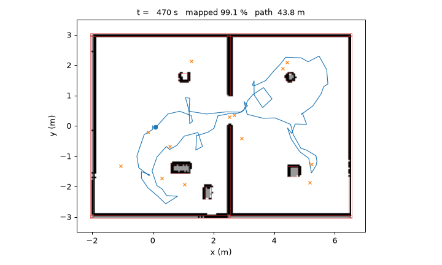
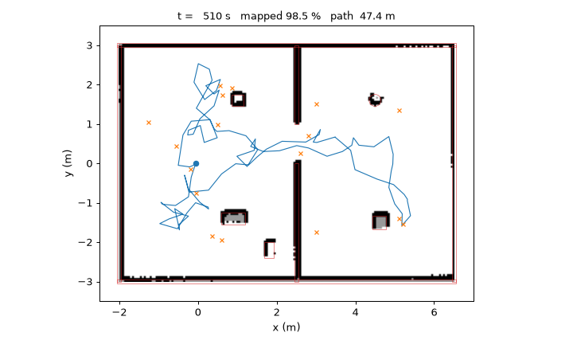

# Phase 3 — autonomous frontier exploration (flat_lab, no prior map)

Date 2026-11-16. Policy `terrain_dr2_15M` (default `policy_node` model), slam_toolbox in mapping mode from an empty map,
Nav2 (MPPI-Omni) with collision_monitor on, lidar self-hit filter on, headless Gazebo, robot spawned at the world origin.
One heavy workload at a time (`docker ps` empty before each run). Numbers below are measured; raw data in `docs/results/data/phase3/explore_{gt,ekf}/`.

## What was built
| piece | where |
|---|---|
| frontier detection / clustering / reachability / scoring (pure numpy, 9 unit tests) | `gurdy_core/gurdy_core/frontier.py`, `gurdy_core/tests/test_frontier.py` |
| ROS node: plan → `NavigateToPose` goal → repeat, blacklist, stop, return to start | `ros2_ws/src/gurdy_navigation/gurdy_navigation/frontier_explorer_node.py` |
| run script, monitor (coverage CSV, stuck detector, map snapshots), renderer | `scripts/phase3_explore_run.sh`, `explore_monitor.py`, `render_explore.py` |
| start-up fix: wait for the three action servers + TF, restart the stack if they never appear | `scripts/wait_nav_ready.py`, `scripts/lib_nav_start.sh` |

No `explore_lite` port exists for Jazzy in the apt index (`ros-jazzy-explore-lite` not found), so the explorer is our own, ~250 lines.
How it works: frontier = free cell with an unknown 4-neighbour → 8-connected clusters (≥ 6 cells = 0.3 m) → Dijkstra over free cells that keep 0.40 m from
walls from the robot (unreachable clusters are skipped) → goal = nearest reachable cell within 0.4 m of the cluster → score = path length − 0.5·min(size, 2 m).
A goal is cancelled when its frontier disappears, when the robot is within 0.35 m for ≥ 4 s ("close enough"), after 150 s, or with < 0.25 m progress in 40 s.
A goal that fails twice, or is visited twice with the frontier still there, is blacklisted (0.6 m radius). Exploration ends when no usable frontier exists
for ≥ 10 sim s **and** the map has stopped growing; the robot then navigates back to its first pose.

## Results (flat_lab, 8.5 m × 6 m, two rooms joined by a 1 m doorway)
| | ground-truth odometry | EKF odometry (legs + IMU) |
|---|---|---|
| time to finish exploring (sim) / return to start included | 345 s / 465 s | 468 s / 510 s |
| lab interior mapped at end (known cells inside the world rectangle) | 99.1 % | 98.5 % |
| mapped at 100 s / 200 s sim | 63 % / 97.5 % | 69 % / 86 % |
| map recall of true walls+objects within 10 cm (`map_quality.py`) | 94.9 % | 93.1 % |
| map precision, mean / p95 | 2.1 cm / 6.7 cm | 2.4 cm / 6.4 cm |
| ground-truth distance driven | 43.8 m | 47.4 m |
| frontier goals: resolved / close enough / failed | 8 / 5 / 0 | 11 / 5 / 1 |
| Nav2 recoveries | 0 | 12 (11 on the one failed goal) |
| stuck events (GT speed < 0.02 m/s for > 10 s while exploring) | 0 real (1 flagged: the 11 s "map stopped growing" check at the end) | 0 |
| returned to start | yes, 0.12 m from start (NavigateToPose SUCCEEDED) | yes, 0.055 m (SUCCEEDED) |
| RTF (10 s windows) | 0.33–0.36 | 0.49–0.52 |
| top-8 process RSS sum at the end | 1.0 GiB | 1.0 GiB |

Notes on the table: "mapped" counts known (free or occupied) cells in the world rectangle; the first jump to ~60 % is the lidar's first view of the room.
The 345 s / 468 s are the times the explorer declared "no frontiers left" (the return trip follows: 120 s resp. 42 s). The one EKF failure is goal 16, a 7.6 m cross-room goal
that hit the 150 s goal timeout after 11 recoveries (the robot was 0.3 m short; the next goals recovered, no blacklist). The EKF map vs the GT map: precision 2.4 cm,
recall 99.8 % within 10 cm of the GT map. RTF differs between the runs because the host was differently loaded (benchmark MuJoCo RTF 55 vs 61); not a property of the odometry source.
Time-lapse (map growing, robot trail blue, goals orange ×): `phase3_explore_{gt,ekf}_timelapse.gif/.mp4`; final map `phase3_explore_*_map.png`; curves `phase3_explore_*_coverage.png`.

 

## Problems found on the way (all fixed)
1. **Start-up flake (item 3):** sometimes Nav2 never finishes bring-up: a DDS service response from `controller_server/change_state` is lost ("failed to send response …
   timeout"), `lifecycle_manager` waits forever at "Configuring controller_server" and the planner/bt_navigator action servers never appear (seen once in about eight launches; re-sending
   RESET/STARTUP hung too). Waiting longer cannot help. `wait_nav_ready.py` waits for `navigate_to_pose`, `compute_path_to_pose`, `follow_path` and TF `map→base_link`;
   `lib_nav_start.sh` restarts the whole stack (≤ 3 attempts, failed launch logs kept) when they don't appear within 90 s. Used by `phase3_nav_run.sh` and `phase3_explore_run.sh`.
   Result: the 4 launches since the helper existed (3 diagnostics + the EKF run) all became ready on attempt 1 ("ready after 3–5 s wall"). The detection was exercised once (the hung launch timed out as intended); the restart-and-retry path itself has **not** been exercised because the flake did not recur.
2. **EKF mode stalled (found by the explorer's first EKF run):** `patch_nav2_params` pointed `bt_navigator` and `velocity_smoother` at `/odometry/filtered` but not `controller_server`, so MPPI
   read the non-existent `/odom`, believed the robot was always at rest and capped its commands near ax_max·dt = 0.04 m/s (mostly < the 0.015 m/s lift threshold). Measured from rest, MPPI's largest command
   (north / east / south goal): GT mode 0.11 / 0.13 / 0.12 m/s, EKF before the fix 0.022 / 0.013 / 0.001, EKF after 0.12 / 0.14 / 0.15
   (`data/phase3/odom_fix/`, `scripts/nav_velocity_diag.sh`). Test added. This also means every earlier `odom_source:=ekf` Nav2 run ran with a blind controller.
3. **Goals inside Nav2's inflation band** (planner clearance 0.25 m → 0.40 m) and **tiny first map** (declared "no frontiers" at t = 5 s → now needs 10 s with a map that stopped growing)
   were found in the first runs; a first GT run (clearance 0.25) reached 99 % in 435 s but then wasted > 150 s on three goals hugging the table.

## Limitations
- One world, one start pose, two runs (one per odometry source): no variance estimate. The distance/time differences between the two runs (43.8 vs 47.4 m) are within what a different RTF/random start can cause.
- Map recall ~93–95 % is not 100 % because the thin cylinder and the box corners are seen from few angles; the lab interior is 99 % known.
- Goals are chosen greedily by distance/size; no information-gain model. Dynamic obstacles, other rooms/worlds and rough terrain are untested.
- `max_visits`/`close enough` heuristics were tuned on these two runs.

## Reproduce
```bash
docker compose run -d --rm --name gurdy_explore sim bash -c 'cd ~/gurdy2 && scripts/phase3_explore_run.sh explore_gt policy ground_truth > docs/results/data/phase3_explore_gt.log 2>&1'
# EKF: ... explore_ekf policy ekf ; wait until `docker ps` is empty, then (rl image):
docker compose run --rm rl bash -c 'python3 scripts/map_quality.py maps/explore_gt.yaml && python3 scripts/render_explore.py docs/results/data/phase3/explore_gt docs/results/phase3_explore_gt'
```
